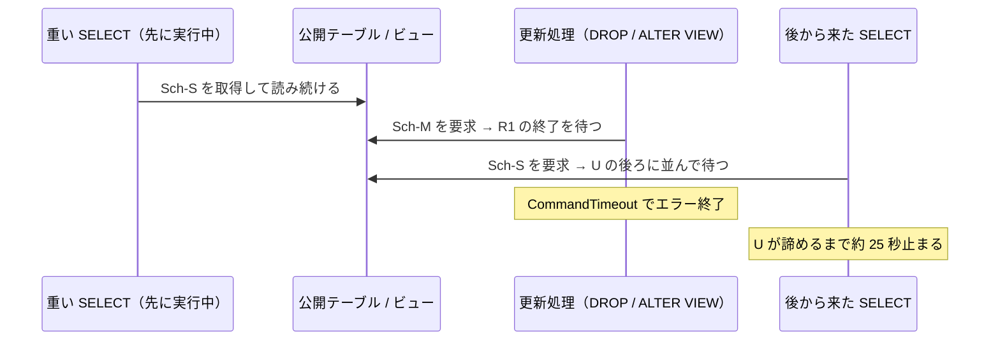
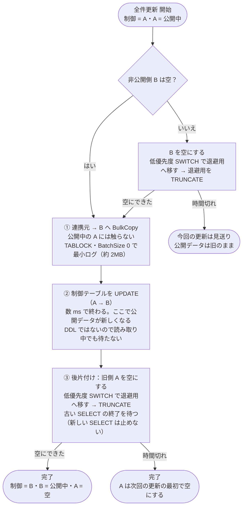
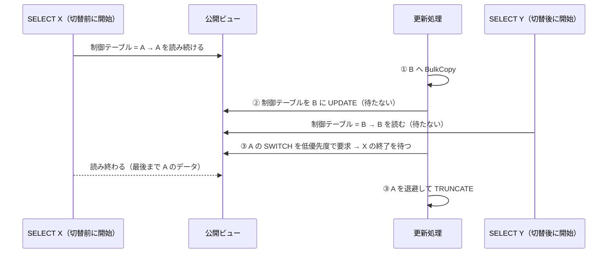

# 全件更新のロック問題　検証まとめ

2026-11-11〜12 に行った検証と検討の内容をまとめます。
アプリの使い方や設定は [README](../README.md) を参照してください。

## 1. 問題

データ公開システムの全件更新は、次の手順で行っています。

1. 新テーブルを作成する
2. 連携元から新テーブルへ BulkCopy する
3. 公開テーブルを DROP する
4. 新テーブルを公開テーブル名にリネームする

公開テーブルに対して重い SELECT が長時間実行されていると、3. の DROP がロックで待たされ、タイムアウトで終了します。

## 2. 結論

| | 内容 |
| --- | --- |
| 改修案（ALTER VIEW による Blue/Green） | **効果なし**。ALTER VIEW も DROP と同じロック（Sch-M）を取るため、DROP と同じように待たされる |
| 本命 | **制御テーブル切替**。A・B の 2 テーブルを交互に使い、公開の切替は制御テーブルの UPDATE だけで行う。旧側は低優先度 SWITCH で退避して TRUNCATE する |
| テーブル名を変えずに最小限の改修で済ませたい場合 | **低優先度 SWITCH**（`ALTER TABLE … SWITCH … WITH (WAIT_AT_LOW_PRIORITY …)`）。切替自体は読み取りの終了を待つが、後から来た SELECT は止めない |

## 3. なぜ DDL で入れ替える方式はうまくいかないのか

### ロックの基本

| 操作 | 取るロック |
| --- | --- |
| SELECT（実行中ずっと） | Sch-S（スキーマ安定度ロック）。「テーブルの構造を変えないで」というロック |
| DROP / sp_rename / ALTER VIEW / シノニムの作り直し / SWITCH / TRUNCATE（DDL） | Sch-M（スキーマ変更ロック）。Sch-S とは両立しない |
| UPDATE / DELETE / INSERT（DML） | 行・ページの X ロック。Sch-S とは両立する |

Sch-M は、実行中の SELECT の Sch-S が外れる（= SELECT が終わる）まで待ちます。
さらに、Sch-M が待っている間に後から来た SELECT は、Sch-M の後ろに並んで止まります。



ALTER VIEW の場合、Sch-M を取る対象がテーブルからビューに変わるだけで、ビューを読んでいる SELECT が Sch-S を持っている点は同じです。そのため結果も同じになります。

### RCSI（READ_COMMITTED_SNAPSHOT）の効果

RCSI を ON にすると、SELECT は行の S ロックを取らずに行バージョンを読むので、**DML（UPDATE / DELETE / MERGE）と SELECT が互いに待たなくなります**。
一方で、SELECT は RCSI でも Sch-S を取るため、**DDL の Sch-M 待ちには効果がありません**。
ユーザー環境では RCSI は既に ON です。

### 低優先度待機（WAIT_AT_LOW_PRIORITY）

`ALTER TABLE … SWITCH` などに `WITH (WAIT_AT_LOW_PRIORITY (MAX_DURATION = n MINUTES, ABORT_AFTER_WAIT = SELF))` を付けると、Sch-M を「低優先度」で待ちます。
低優先度で待っている間は、**後から来た SELECT が先にロックを取れる**ので止まりません（待機種別は `LCK_M_SCH_M_LOW_PRIORITY`）。
MAX_DURATION を過ぎると、SELF なら自分（更新側）がエラー 1222 で中止します。

## 4. 各方式の検証結果

Mac 上の SQL Server 2022（Docker）で、30 万行のテーブルを低速で読み続けている間に更新しました。
読み取りは「読取1：切替の 10 秒前から読み続ける」「読取2：切替開始の 5 秒後に新たに SELECT」の 2 本です。

| 方式 | RCSI | 更新 | 読取2（後から来た SELECT）の待ち |
| --- | --- | --- | --- |
| 現行 DROP + RENAME | OFF | タイムアウト | 約 25 秒 |
| 改修案 ALTER VIEW | OFF / ON | タイムアウト（LCK_M_SCH_M） | 約 25 秒 |
| 参考：シノニム | OFF | タイムアウト | 約 25 秒 |
| SWITCH（通常の優先度） | OFF | タイムアウト（LCK_M_SCH_M） | 約 25 秒 |
| SWITCH（低優先度） | OFF | 読取1 の終了を待って成功（約 50 秒待機） | **なし** |
| SWITCH（低優先度・読取1 が 120 秒） | ON | 1 分で切替を中止（エラー 1222）。公開データは旧のまま | **なし** |
| 制御テーブル切替 | OFF | 成功。ただし DELETE が読取1 を約 36 秒待機（LCK_M_X） | なし |
| 制御テーブル切替 | ON | 待機なしで成功 | **なし** |
| 全件同期 MERGE | ON | 待機なしで成功 | なし |
| 差分更新 MERGE | ON | 待機なしで成功 | なし |

別の AI が挙げた候補については、次のとおりです。

| 候補 | 評価 |
| --- | --- |
| パーティション SWITCH | 通常の優先度では DROP と同じく待つ。**低優先度にすれば後続の SELECT は止まらない**（切替自体は待つ） |
| Read Replica への参照退避 | 単一サーバーでは検証できないため対象外。セカンダリでも DDL を再生する redo が SELECT の Sch-S を待つため、DDL で入れ替える方式のままでは反映の遅れとして問題が残る |
| 差分更新方式への変更 | RCSI ON なら待たない。ただし連携元で差分を取れることが前提 |
| テーブルの再編成（全件入替をやめる） | 全件同期 MERGE として検証。RCSI ON なら待たない。ただし変更行が多いとログ量が多い |

## 5. 本命：制御テーブル切替

### 構成

| オブジェクト | 役割 |
| --- | --- |
| `vt_Ctl_A` / `vt_Ctl_B` | データを入れる 2 つのテーブル。片方が公開中、もう片方は空 |
| `vt_CtlActive` | 制御テーブル。今どちらを公開しているか（`'A'` / `'B'`）を 1 行だけ持つ |
| `vt_CtlView` | 公開ビュー。**定義は固定**で、運用中に作り直さない |
| `vt_Ctl_Trash` | 退避用の空テーブル。旧側を空にするときに使う |

```sql
-- 公開ビュー：制御テーブルを 1 回だけ読み、その値の側だけを読む
CREATE VIEW vt_CtlView AS
SELECT x.*
FROM vt_CtlActive c
CROSS APPLY (
    SELECT … FROM vt_Ctl_A WHERE c.ActiveSide = 'A'
    UNION ALL
    SELECT … FROM vt_Ctl_B WHERE c.ActiveSide = 'B'
) x
WHERE c.Id = 1;
```

利用者は今までどおり公開ビューを SELECT するだけです。

### 全件更新 1 回分の流れ（A が公開中の場合）



次回の更新では A と B の役割を入れ替えて、同じ流れを実行します。

SQL にすると次のようになります。

```sql
-- 非公開側を空にする（準備・後片付けで共通）
TRUNCATE TABLE vt_Ctl_Trash;
ALTER TABLE vt_Ctl_B SWITCH TO vt_Ctl_Trash
    WITH (WAIT_AT_LOW_PRIORITY (MAX_DURATION = 2 MINUTES, ABORT_AFTER_WAIT = SELF));
TRUNCATE TABLE vt_Ctl_Trash;

-- ① BulkCopy（アプリ側）
--   SqlBulkCopy(SqlBulkCopyOptions.TableLock) / DestinationTableName = vt_Ctl_B / BatchSize = 0

-- ② 切替
UPDATE vt_CtlActive SET ActiveSide = 'B' WHERE Id = 1;

-- ③ 後片付け（旧側 A を空にする）
TRUNCATE TABLE vt_Ctl_Trash;
ALTER TABLE vt_Ctl_A SWITCH TO vt_Ctl_Trash
    WITH (WAIT_AT_LOW_PRIORITY (MAX_DURATION = 2 MINUTES, ABORT_AFTER_WAIT = SELF));
TRUNCATE TABLE vt_Ctl_Trash;
```

### 読み取り側から見た動き



- ②より前に始まった SELECT は、最後まで旧データ（A）を読みます。途中で B に変わったり、新旧が混ざったりしません。
- ②より後に始まった SELECT は新データ（B）を読みます。
- どの SELECT も待たされません。待つのは③の後片付けだけで、公開が済んだ後なので利用者には影響しません。
- ③で待つ理由：ビューを読んでいる SELECT は、読んでいない側のテーブルにも Sch-S を持ちます。そのため、古い SELECT が終わるまでは A をすぐに SWITCH / TRUNCATE できません。

## 6. トランザクションログの問題

### 以前の DELETE + INSERT が重かった理由

- DELETE は、復旧モデルが SIMPLE でも**全行をログに書きます**（30 万行で約 280MB）。
- 1 トランザクションで消すと、その間ログを切り捨てられないため、ログファイルが自動拡張します。拡張のたびに領域の初期化が入り、さらに遅くなります。
- インデックスの更新や、RCSI の行バージョン（tempdb）の作成も、行ごとに発生します。
- DELETE した後のテーブルへの投入は、空のテーブルとして扱われないため最小ログになりません（さらに約 290MB）。

### 本命での対策

| 手順 | 以前（DELETE + INSERT） | 本命 |
| --- | --- | --- |
| 空にする | DELETE（全行がログに書かれ、時間がかかる） | 低優先度 SWITCH で退避 → TRUNCATE（ログほぼ 0、一瞬） |
| 投入 | DELETE 後のテーブルなので最小ログにならない | 本当に空のテーブルへ TABLOCK・BatchSize 0 で投入するので最小ログ |
| 書き込む先 | 公開中のテーブル | 公開していない側だけ |

最小ログになる条件は、復旧モデルが SIMPLE（または BULK_LOGGED）、投入先が空のテーブル、TABLOCK 指定 の 3 つです。
BatchSize を指定するとバッチごとにコミットされ、2 バッチ目以降は「空ではないテーブル」への投入になるため、ログが増えます。
BatchSize = 0 は全件を 1 トランザクションで投入するので、途中で失敗すると投入した分は全部取り消されますが、非公開側への投入なので公開データには影響しません。

### 実測（SIMPLE・RCSI ON・30 万行 ≒ 270MB・2 回更新の合計）

| 方式 | ログ書込量 | ログファイル |
| --- | --- | --- |
| 制御テーブル切替 + DELETE で空にする（プリセット⑨） | **601 MB** | 136 → 648 MB に膨張 |
| 本命（BatchSize = 10,000） | 57 MB | 72 → 136 MB |
| 本命（BatchSize = 0、プリセット⑧） | **4.4 MB** | 増えず |

本命ではどちらの更新も切替は 2〜57ms で終わり、読み取りは待たされませんでした。後片付けは読取1 の終了を約 50 秒待ちました。

## 7. 本命の注意点

- **前提**：RCSI ON（済）、復旧モデル SIMPLE（済）。RCSI が OFF だと、差分更新の MERGE や DELETE で空にする場合に、読み取りを待ちます。
- **ディスク**：A・B の 2 面分の領域が必要です（後片付けが済めば片側は空）。
- **後片付けが終わらない場合**：公開ビューを読む SELECT が途切れずに重なり続けると、③の低優先度 SWITCH が実行できる隙間がなく、時間切れになります。その場合は次回の更新の最初に空にし、それでも空にできなければその回の更新を見送ります（公開データは旧のまま、利用者への影響はなし）。DELETE に切り替えることはしません。
- **ビューの実行計画**：CROSS APPLY の形により、実行時には片側のテーブルだけが読まれます。本番のクエリ（WHERE・JOIN 付き）で実行計画を確認してください。
- **インデックス・制約**：A・B・退避用テーブルは、SWITCH の条件として同じ構造（列・インデックス・ファイルグループ）にそろえる必要があります。
- **差分更新**：公開中の側（制御テーブルが指す側）へ MERGE します。RCSI ON なら待ちません。

## 8. 検証サーバーでの確認手順

1. 「環境セットアップ」タブで **セットアップ実行** をやり直す（`vt_Ctl_B` を空で作成し、`vt_Ctl_Trash` を追加したため）。
2. RCSI と復旧モデルの表示を確認する（RCSI = ON、復旧モデル = SIMPLE）。ログ量の表示には `VIEW SERVER STATE` 権限が必要です。
3. プリセット **⑧ 本命** を実行し、切替時間・読み取りの待ち・ログ書込量を確認する。
4. プリセット **⑨ DELETE との比較** を実行し、ログ書込量とログファイルの増え方を ⑧ と比べる。
5. 比較用に、プリセット ① 現行方式・② ALTER VIEW も実行しておくと、改善の差が分かりやすくなります。

## 9. 経緯

| 日付 | 内容 |
| --- | --- |
| 2026-11-11 | 現行方式と改修案（ALTER VIEW）を再現する検証アプリを作成。改修案でも ALTER VIEW が Sch-M で待ち、ロック問題は解消されないことを確認 |
| 2026-11-11 | 読み取りの開始を更新の切替に連動させ、「切替待ち中に後から来た SELECT」を確実に再現できるようにした |
| 2026-11-12 | 代替案（低優先度 SWITCH・制御テーブル切替・全件同期 MERGE・差分更新・RCSI 切替）を検証できるようにした |
| 2026-11-12 | ユーザー環境（RCSI ON・SIMPLE）で問題だったログ量への対策として、低優先度 SWITCH での退避＋TRUNCATE、BatchSize 指定、段階ごとのログ量計測を追加 |
